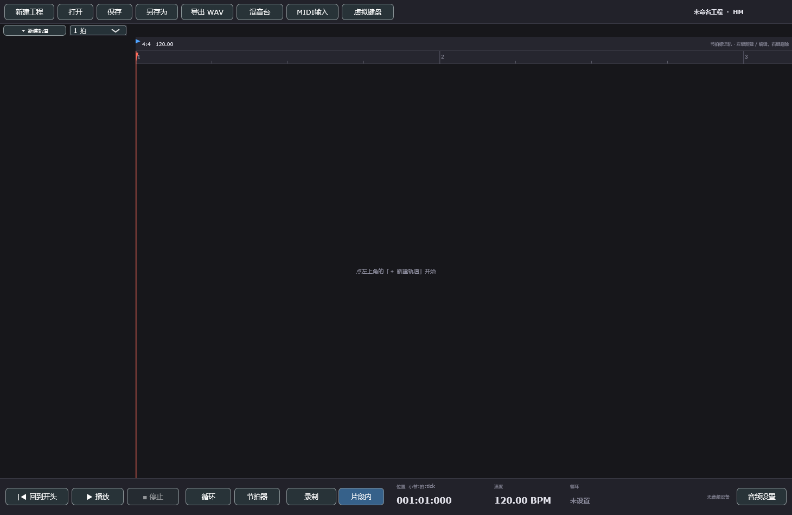
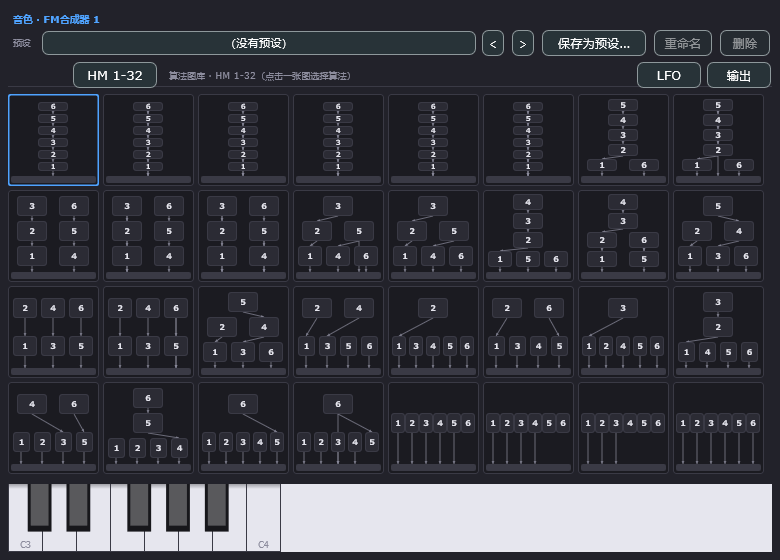
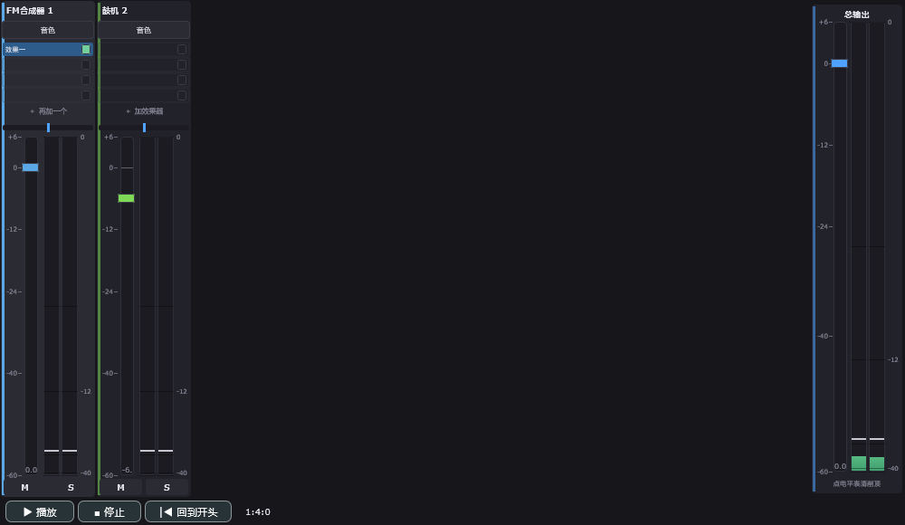
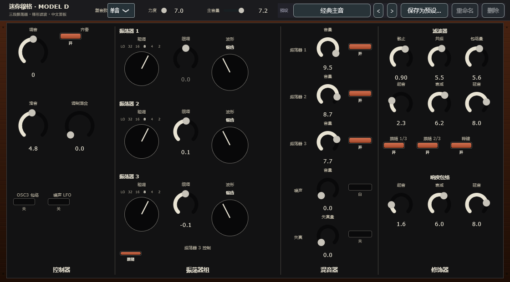

# HM

[下载 Windows x64 版](https://github.com/jinhao-gh/HM/releases/latest)

HM 是一个面向 Windows 的开源数字音频工作站（DAW），使用 C++20、JUCE 8 和 CMake 构建。它把时间线编曲、钢琴卷帘、混音器、VST3 宿主、音频导出，以及一套内置合成器/鼓机放在同一个原生应用里。

> 这是个人独立开发的项目，不是商业产品。内置的 FM、Minimoog 风格乐器是**非官方**实现，与 Yamaha、Moog 没有任何关联。



## 功能

- **工作区**：顶栏分为文件、工作室、编排、接线、混音台；文件菜单负责新建/打开/保存/另存为/导出。
- **工作室**：2D 俯视声学空间；乐器、音箱、麦克风、一分多/多合一、混音台接口、墙壁；可拖动、连接并由页面内多个可拖动检查器编辑。支持麦克风指向、音箱方向、距离衰减、墙壁遮挡和一阶反射。
- **编曲**：多轨时间线、音频/MIDI 片段、钢琴卷帘、速度标记、循环与导出；底部状态栏有 MIDI 输入和虚拟键盘按钮，硬件 MIDI 在所有页面都能演奏当前选中乐器。
- **混音**：页面式 SSL 4000E 风格混音台，每通道选择工作室输入接口，带 trim、HPF、低频/高频、声像、推子、M/S 和主输出。
- **接线**：占位页，效果器组织留待后续；现有每轨效果链保持可用。
- **内置乐器**：
  - FM / DX7 风格六算子合成器（64 条算法，含 32 条 DX7 路由）
  - 减法合成器
  - 波表合成器
  - 粒子合成器
  - 混合合成器
  - 鼓机
  - 采样器
  - Minimoog Model D 风格乐器（单音/复音、力度、齐奏、失真、梯形滤波）
  - GM 音色：128 个 General MIDI 音色 + GM 鼓组，基于 GeneralUser GS SoundFont
- **插件**：VST3 乐器与效果器宿主。
- **工程**：JSON 工程文件、用户预设库、撤销/重做、离线渲染。
- **质量**：数千条单元测试断言和离屏自检快照（见 `HMDAW/docs/06-testing.md`）。







## 构建

### 要求

- Windows 10/11 x64
- Visual Studio 2022 或 2026，安装 **Desktop development with C++** 工作负载（MSVC + Windows SDK）
- CMake 3.22+
- Ninja
- Git

JUCE 8.0.15 已经随仓库放在 `HMDAW/external/JUCE`，正常构建不需要联网。GM 音色库 `GeneralUserGS.sf2`（约 32 MB）在 `HMDAW/Resources`，构建时会复制到 `HM.exe` 同目录。

### 命令

```powershell
git clone https://github.com/<你的用户名>/<仓库名>.git
cd <仓库名>

# 构建主程序（Release）
work\build_app.bat HMDAW

# 构建单元测试
work\build_tests22.bat
```

产物：

```text
work/app-build5/HMDAW_artefacts/Release/HM.exe
```

运行：

```powershell
.\work\app-build5\HMDAW_artefacts\Release\HM.exe
```

强制全量重建：

```powershell
work\build_app.bat HMDAW clean
```

### 在 VS Code 中构建/运行

用 VS Code 打开 `HMDAW` 子目录（不是仓库根目录），按 `F5` 选择 `HM: run (Release)`；`Ctrl+Shift+B` 只构建。配置见 `HMDAW/.vscode/`。

## 目录

```text
HMDAW/
  Source/        应用、音频引擎、UI、测试、自检
  docs/          需求、架构、UI、构建、测试、路线图
  devlog/        开发日志
  external/JUCE/ 随仓库的 JUCE 8.0.15
  cmake/         共享源码列表
  TestPlugin/    VST3 测试插件
work/            构建、测试、发布脚本
```

## 已知限制

- 只针对 Windows/x64 构建和验证；macOS/Linux 未测试。
- 发布包使用本机自签名证书，只对本机可信；公开下载的 exe 会显示“未知发布者”。
- 波表编辑器相关自检在部分环境下不稳定；如遇失败请重跑，或只跑单元测试。
- 部分音色/参数是行为级近似，不是逐样本的硬件复刻。
- GM 音色每条轨道只能选择一个 program；要同时播放多个 GM 音色需要建多条轨道，暂不支持 16 通道多音色模块或 MIDI 文件导入。
- 工作室声学是 2D 直接路径 + 一阶镜像反射近似，不含高度、衍射、晚期混响或箱体卷积；音箱为参数化频响/指向模型。
- 混音台暂不含 SSL 动态、侧链和自动化；单轨 stem 导出仍是效果链后的干轨，不经过工作室声学。
- 工程文件和预设格式仍可能随版本调整。

## 许可证

本项目以 **GNU Affero General Public License v3.0（AGPL-3.0）** 发布，见 [LICENSE](LICENSE)。

因为项目链接 JUCE 8，而 JUCE 采用 AGPLv3/商业双许可，所以整体按 AGPL-3.0 分发；如果你需要非 AGPL 的闭源分发，需要自行取得 JUCE 商业许可并替换相应授权。

第三方组件、音色数据来源与商标声明见 [NOTICE](NOTICE)。

## 开发说明

项目在开发过程中使用了 AI 编程助手辅助实现部分代码；需求、架构、参数校准、代码审查、测试与发布由作者负责。提交前请自行检查第三方代码/素材的许可证兼容性。

## 贡献

欢迎 issue 和 PR。提交前请先阅读 `HMDAW/docs/05-build-env.md` 和 `HMDAW/docs/06-testing.md`，并确保构建无 `HMDAW/Source` 警告、相关测试通过。
